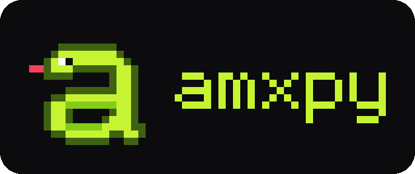

<p align="center"></p>

# amxpy

Плагины AMX Mod X 1.9+ для Counter-Strike 1.6 на Python 3.14.

**Документация: [kotyarakryt.github.io/amxpy](https://kotyarakryt.github.io/amxpy/)**

amxpy — модуль AMX Mod X со встроенным CPython. Плагин — обычный модуль Python с типами:
компилятор amxpyc проверяет его до запуска, тесты гоняют его на сервере в памяти, а
`amxpy deploy` обновляет его на работающем сервере без рестарта.

```python
from amxpy import Player, Plugin, events, sleep

plugin = Plugin("Hello", version="1.0.0")


@plugin.on(events.PutInServer)
async def greet(e: events.PutInServer) -> None:
    player = e.player
    await sleep(3)                      # сервер в это время не ждёт
    player.print(f"!gПривет, !t{player.name}!y!")


@plugin.command("/hp")
def hp(player: Player) -> None:
    player.print(f"HP: {player.health}")
```

## Возможности

- события ReGameDLL с pre/post, отменой и изменением полей;
- команды с разбором аргументов по аннотациям, доступом и кулдауном;
- меню, HUD и DHUD; cvar'ы, файлы настроек, SQLite и переводы;
- asyncio прямо в игровом кадре;
- горячая перезагрузка с переносом состояния и откатом при ошибке;
- вызов любых нативов AMXX, форварды Pawn ↔ Python, свои нативы для Pawn-плагинов;
- FakeServer для pytest и расширение VS Code с подсказками по нативам.

## Быстрый старт

```bash
python3.14 -m venv .venv && source .venv/bin/activate
pip install -e '/путь/к/amxpy[dev]' --config-settings editable_mode=compat
amxpy init my-plugins --game /путь/к/cstrike
cd my-plugins && pytest && amxpy deploy
```

Подробно — [Первый плагин](docs/start/first-plugin.md).

## Документация

| Раздел | |
|---|---|
| [Установка](docs/start/install.md) | модуль на сервер и пакет для разработки |
| [Первый плагин](docs/start/first-plugin.md) · [Проект и деплой](docs/start/project.md) · [VS Code](docs/start/vscode.md) | начало работы |
| [Руководство](docs/guide/events.md) | события, команды, игроки, меню, cvar'ы, async, хранилище, перезагрузка, тесты |
| [Pawn и AMXX](docs/pawn/amxx-call.md) | нативы AMXX из Python, форварды, API для Pawn-плагинов |
| [Примеры](docs/examples/index.md) | готовые плагины с тестами — исходники в [examples/plugins](examples/plugins) |

Справочник API, каталог событий и коды диагностик строятся из кода — смотрите их
[на сайте](https://kotyarakryt.github.io/amxpy/reference/). Собрать сайт локально:

```bash
pip install -e '.[docs]'
mkdocs serve                # http://127.0.0.1:8000
```

## Требования

- сервер: Linux, HLDS или ReHLDS, Metamod-R, AMX Mod X 1.9+; для игровых событий — ReGameDLL;
- разработка: Python 3.14 — байткод плагинов привязан к версии CPython на сервере.

## Разработка amxpy

```bash
pytest                      # рантайм, amxpyc, примеры, FakeServer
scripts/test-module.sh      # C++-модуль в фейковом HLDS + Metamod + AMXX
mkdocs build --strict       # сайт документации → site/
```

### Сборка из исходников

```bash
scripts/fetch-sdk.sh        # cssdk, metamod и include AMXX (закреплённые коммиты)
scripts/docker-build.sh     # переносимая сборка в i386/debian:bullseye: CPython 3.14 со статическими
                            # OpenSSL и SQLite → build/runtime-i386, модуль → build/module (glibc ≥ 2.31)
scripts/package.sh          # архив для сервера → dist/amxpy-<версия>-linux-i386.tar.gz
scripts/build-vscode.sh     # расширение VS Code → dist/amxpy-vscode-<версия>.vsix
python3 scripts/make-logo.py  # логотип из пиксельной сетки → docs/assets/, иконка расширения
# картинка для соцсетей (GitHub Social preview и og:image сайта) → docs/assets/social.png:
firefox --headless --window-size=1280,640 --screenshot docs/assets/social.png "file://$PWD/scripts/social-preview.html"
```

`scripts/build-runtime.sh` собирает тот же рантайм без Docker, но бинарники привязаны к glibc
машины сборки; нужны gcc-multilib и 32-битный zlib. Сервер в Docker: `scripts/deploy-docker.sh`.

| Каталог | Что внутри |
|---|---|
| `amxpy/` | рантайм; `compiler/` — amxpyc; `testing/` — FakeServer |
| `module/` | C++-модуль AMXX (`src/`) и фейковый HLDS (`tests/harness.cpp`) |
| `examples/plugins/` | примеры плагинов |
| `editors/vscode/` | расширение amxpy для VS Code |
| `docs/`, `overrides/` | сайт документации; генерация из кода — `scripts/mkdocs_hooks.py` |
| `tests/` | тесты pytest |
| `scripts/` | сборка рантайма, SDK, модуля, дистрибутива и расширения |

## Лицензия

GPL-3.0-or-later, см. [LICENSE](LICENSE).
